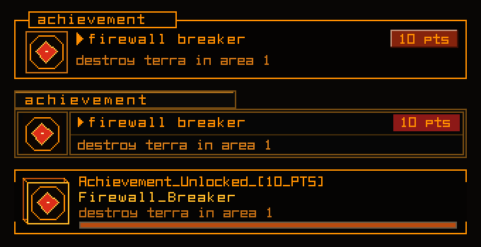
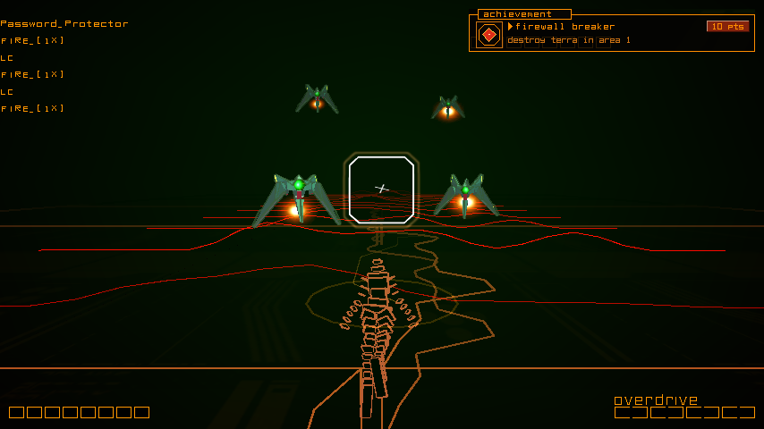
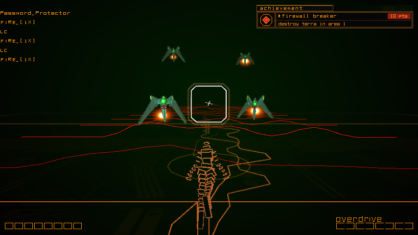
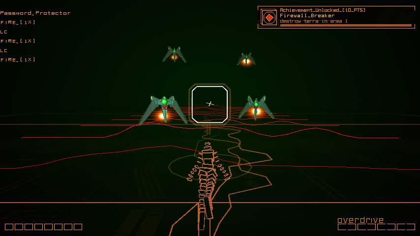

# Rez Recompiled (PortMaster OpenGL ES 3.0)

A static C++ recompilation of **Rez** (Sega Dreamcast, 2001) tailored for **PortMaster** Linux handhelds (`aarch64`) and Linux desktop (`x86_64`).

Forked from [tyrannotorus/recomp-dreamcast-rez](https://github.com/tyrannotorus/recomp-dreamcast-rez), this port replaces the desktop Vulkan renderer with a lightweight **OpenGL ES 3.0** rendering pipeline, adds multi-aspect handheld display ladders, and integrates PortMaster's first-boot disc verification and patching workflow.

## Screenshots

| Title Screen (`16:9` Widescreen) | Area 1 Gameplay (`16:9` Widescreen) |
| :---: | :---: |
|  |  |
| **Area Select (`3:2` Handheld)** | **In-Game Recomp Settings (`3:2` Handheld)** |
|  |  |

## Highlights

- **Static SH-4 Recompilation**: Translates the original Dreamcast binaries (`1ST_READ.BIN` and stage overlays) ahead-of-time into native C++ with no CPU interpreter or JIT overhead.
- **Unified OpenGL ES 3.0 Renderer**: Built for embedded handheld GPUs across **Mali-G31 MP2** (Anbernic H700 family), **PowerVR GE8300** (TrimUI Brick / Smart Pro), **Mali-G52** (RK3566), and **Adreno**, with no Vulkan requirement.
- **Clean Room / Disc-Keyed Packaging**: Release packages (`rez.zip`) ship zero Dreamcast executable bytes. On first launch, PortMaster's built-in patcher (`patcher.txt`) verifies the user's `.chd` disc image, extracts `1ST_READ.BIN`, and reconstructs the `rez.aarch64` executable in ~15 seconds.
- **In-Game Recomp Settings (`Options -> Recomp Settings`)**:
  - **Aspect Ratio**: `4:3`, `3:2`, `16:9` (`Hor+` widescreen FOV), and `1:1` (`Vert+` square handheld FOV), with automatic 2D HUD and pause-menu un-stretching and first-boot screen auto-detection.
  - **Resolution Ladders**: Native handheld resolutions plus sub-native performance step-downs for each aspect ratio:
    - **`4:3`**: `320x240`, `480x360`, `640x480`, `800x600`, `960x720`, `1024x768`, `1280x960`
    - **`3:2`**: `360x240`, `480x320`, `540x360`, `720x480`, `960x640`, `1080x720`
    - **`16:9`**: `426x240`, `640x360`, `854x480`, `960x544`, `1280x720`, `1920x1080`
    - **`1:1`**: `240x240`, `360x360`, `480x480`, `540x540`, `720x720`
  - **Frame Rate**: Toggle between `30 fps` (original Dreamcast pacing) and `60 fps` (60 Hz logic and rendering) on the fly.
  - **Achievements**: Toggle RetroAchievements tracking, choose between three Rez-native top-right toast banner styles (`pause tab`, `options`, `k-project`), and trigger manual award synchronization directly from the menu.
- **RetroAchievements (Softcore Mode)**:
  - Full achievement tracking with non-blocking disc hashing (`rhash`), zero-delay SH-4 memory reads, and passive top-right GPU toast popups rendered via the Rez HUD pipeline in three selectable native UI styles (`pause tab`, `options`, and `k-project`).
  - Automatic 3-tier credentials discovery: searches `settings.ini`, NextUI `minuisettings.txt` (or `ra_auth.txt`), and handheld RetroArch CFW configs across muOS, ArkOS, Knulli, and Rocknix.
  - Resilient offline queuing: awards earned offline are safely persisted in `ra_cache/` and automatically synchronized when an internet connection becomes available, with manual sync accessible anytime from Recomp Settings.

## Supported Disc Images

You must supply your own Dreamcast **Rez** (V1.003) `.chd` disc image:

| Region | Product ID | Version | CHD SHA-1 |
|---|---|---|---|
| **Japan** | `HDR-0178` | `V1.003` | `9711a0d0c21af3685672b9a42c72abf999fc7150` |
| **Europe** | `MK-5119250` | `V1.003` | `01b7c1cc29a840b141a4ae713037eb1224fac233` |
| **Europe** | `MK-5119250` | `V1.003` | `b02e62788394f59c34fcd07d19a7dd80b47fb76e` |
| **Europe** | `MK-5119250` | `V1.003` | `66bfa7cf95348746f61e36a50c77050d380ca3aa` |

## Installing on PortMaster

1. Download `rez.zip` from the [Releases](https://github.com/Pobega/rez-portmaster/releases) page (or build it via `python3 tools/dc.py package`).
2. Extract `rez.zip` into your SD card's `ports/` directory (creating `ports/Rez.sh` and `ports/rez/`).
3. Copy your Rez `.chd` disc image into `ports/rez/gamedata/`.
4. Launch **Rez** from PortMaster. On first boot, PortMaster's patcher screen will verify your `.chd` and build the executable (~15 seconds).

## RetroAchievements

Rez Recompiled features native **RetroAchievements** integration operating in **Softcore mode** via an embedded [`rcheevos`](third_party/rcheevos) runtime. It provides zero-overhead SH-4 memory tracking, asynchronous disc identification (`rhash`), resilient offline queueing, and passive top-right GPU toast banners rendered in native Rez visual styles.



### Credential Setup (3-Tier Auto-Discovery)

Credentials are automatically resolved at boot across three tiers, requiring zero extra configuration on common handheld setups:

1. **`settings.ini` (`ports/rez/conf/rez_recompiled/settings.ini`)**: Set credentials directly in the port's settings file:
   ```ini
   ra_enabled = true
   ra_username = your_username
   ra_token = your_web_api_token
   ra_toast_style = pause_tab
   ```
   *(Note: `ra_password` can also be used if an API token has not yet been generated; the runtime exchanges it for an API token on first login).*
2. **NextUI / Minarch**: Falls back to `minuisettings.txt` (`ra_username`, `ra_token` / `ra_password`) or `ra_auth.txt` from the SD card root or system configuration directories.
3. **Handheld RetroArch CFWs**: Reads `cheevos_username` and `cheevos_token` (or `cheevos_password`) directly from `retroarch.cfg` across **muOS**, **ArkOS**, **Knulli**, and **Rocknix**.

### In-Game Recomp Settings

Open **Options -> Recomp Settings** from the title screen to configure achievements:

- **`RetroAchievements`** (`on` / `off`): Toggles runtime achievement tracking and toast banners.
- **`RA: <login_status>`**: Shown when RetroAchievements are enabled; displays the current account status (`Offline`, `No account setup`, or the logged-in username).
- **`toast style`** (`pause tab` / `options` / `k-project`): Shown when RetroAchievements are enabled; selects the visual theme for notifications and immediately triggers a live preview toast in the top-right corner.
- **`Sync RetroAchievements`**: Shown when RetroAchievements are enabled; displays **`Progress (X/Y)`** and **`Unsynced: N`** in its right-hand subpanel, and pressing confirm triggers an immediate connection and awards synchronization flush.

### Offline Mode & Synchronization

When playing without a network connection:
- If cached data exists in `ports/rez/conf/rez_recompiled/ra_cache/`, achievements evaluate offline against cached definitions and badge art.
- Unlocked achievements are recorded to `ra_cache/` and rewarded immediately in-game.
- Queued awards automatically synchronize upon booting with an active internet connection, or when manually triggering **`Sync RetroAchievements`** in Recomp Settings.

### Toast Banner Styles

Toasts appear non-intrusively in the top-right corner at `1x` scale (or `2x` scale on displays `>= 720p`), keeping the playfield, lock-on reticle, and lower HUD gauges clear:

| Pause Tab (`pause_tab`) | Options (`options`) | K-Project (`k_project`) |
| :---: | :---: | :---: |
|  |  |  |
| Stepped Katana-orange tab frame matching the in-game pause dialog | Double-bordered bronze subpanel matching the main options screen | Cybernetic terminal wireframe HUD with bottom Area Select analyzer bar |

## Controls

| Action | Handheld Control | Desktop Keyboard |
|---|---|---|
| **Targeting / Menus** | D-Pad / Left Stick | Arrow Keys / WASD |
| **Lock-on / Shoot / Confirm** | A / X | Space / Z / Enter |
| **Overdrive / Cancel** | B | X / Left Shift |
| **Pause / Menu** | Start | Escape / Return |
| **Controller Bindings** | Select | F1 |
| **Toggle FPS Counter** | `Select + Y` | F3 |
| **Exit Game** | `Menu + Start` or `Select + Start` | `Alt + F4` |

## Configuration & Save Data

- **In-Game Display & FPS Settings**: Persisted automatically to `ports/rez/conf/rez_recompiled/settings.ini`.
- **RetroAchievements Credentials & Cache**: Set `ra_username` and `ra_token` (or `ra_password`) in `settings.ini` or rely on automatic CFW credential discovery. Queued offline unlocks and badge art are cached in `ports/rez/conf/rez_recompiled/ra_cache/`.
- **Controller Bindings**: Customizable in `ports/rez/conf/rez_recompiled/bindings.txt`.
- **VMU Save Data**: Stored in `ports/rez/conf/rez_recompiled/vmu_a1.bin`.

## Building from Source

See [BUILDING.md](BUILDING.md) for instructions on setting up the `aarch64` sysroot toolchain, building for PortMaster or Linux desktop, and generating the `rez.zip` release archive.

## Credits

- [**tyrannotorus / recomp-dreamcast-rez**](https://github.com/tyrannotorus/recomp-dreamcast-rez) — Original Rez static recompilation
- [**phobos665 / dream-recomp**](https://github.com/phobos665/dream-recomp) — `dream-recomp` SH-4 static recompilation engine
- [**cherryduck / dreamcomp**](https://github.com/cherryduck/dreamcomp) — Dreamcast recompilation research and foundation
- [**flycast**](https://github.com/flyinghead/flycast) — Dreamcast hardware and Holly/AICA reference

## License

GPL-2.0 — see [LICENSE](LICENSE) and [THIRD_PARTY_NOTICES.md](THIRD_PARTY_NOTICES.md).
